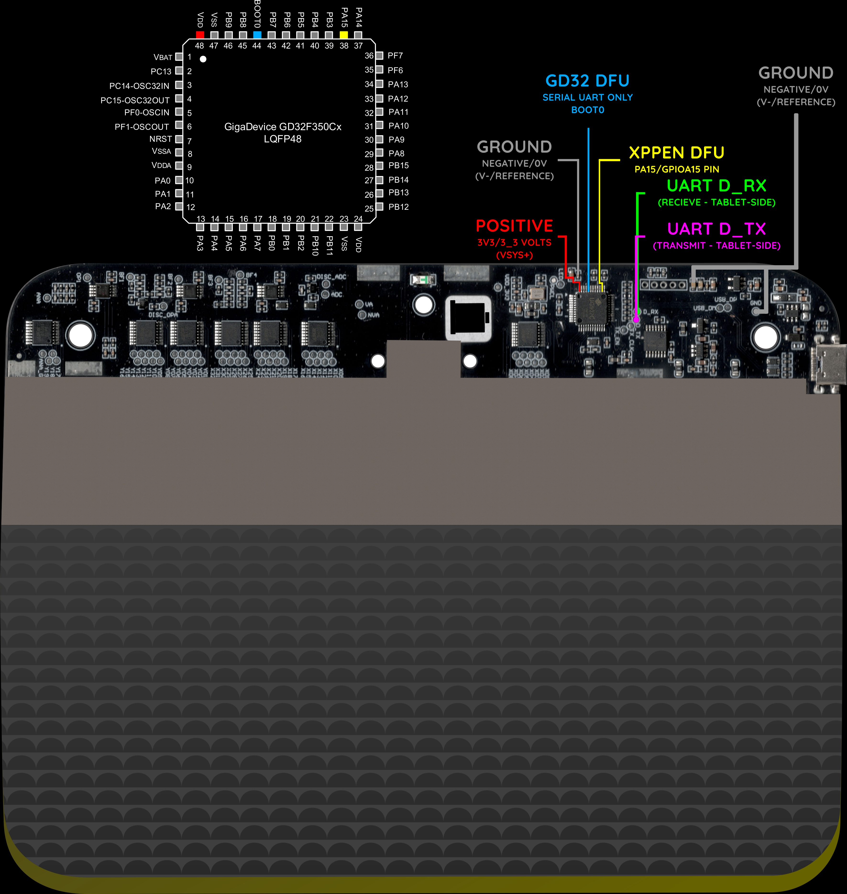

# Deco640 Resources


Resources for the XP-Pen Deco 640 (IT640): the stock firmware of every known release, and a step-by-step guide to
opening the tablet and recovering it by hand.

> [!NOTE]
> This README is mostly AI generated, from an outline written by a human.
> However, most of this repository's contents are human-made, and this document has been reviewed by a human.

## Contents

- [Deco640 Resources](#deco640-resources)
  - [Contents](#contents)
  - [What's here](#whats-here)
  - [Firmware](#firmware)
    - [Flashing a tablet](#flashing-a-tablet)
    - [Adding a firmware version](#adding-a-firmware-version)
  - [Hardware recovery](#hardware-recovery)
    - [Disassembly guide](#disassembly-guide)
    - [Board pads](#board-pads)
    - [Recovery, in order](#recovery-in-order)
  - [Related repositories](#related-repositories)

## What's here

| Folder | Holds | Used for |
|---|---|---|
| [`dumps/`](dumps) | one folder per firmware version, each with that version's stock files | flashing a tablet back to stock; the automated tests of `Anargon-osu/anargons-tablet-tools` |
| [`recovery/`](recovery) | the disassembly guide, three high-resolution pages | opening the tablet and reaching the board when USB is not enough |

## Firmware

Each folder under `dumps/` is named after a firmware version, exactly as the firmware names itself.

| Version | Build date | Folder |
|---|---|---|
| `2025-02-14_release001` | 14 February 2025 | [`dumps/2025-02-14_release001/`](dumps/2025-02-14_release001) |
| `2025-12-23_release001` | 23 December 2025 | [`dumps/2025-12-23_release001/`](dumps/2025-12-23_release001) |

Every version folder holds the same four files:

| File | Size | What it is | Flash address |
|---|---|---|---|
| `ic902-main.bin` | 64 KB | the whole flash: bootloader and firmware | `0x08000000` to `0x0800FFFF` |
| `ic902-bootloader.bin` | 14 KB | the bootloader alone (the first 14 KB of `ic902-main.bin`) | `0x08000000` to `0x080037FF` |
| `ic902-code.bin` | about 36 KB | the firmware alone, up to its last byte | from `0x08003800` |
| `ic902-stock.hex` | about 100 KB | `ic902-code.bin` as Intel HEX: the file that returns a tablet to stock | from `0x08003800` |

> [!TIP]
> Not sure which version a tablet runs? Back it up (below) and give the `ic902-main.bin` to Anargon's Basic Tablet
> Recovery: it prints the version as "Firmware build".

### Flashing a tablet

In order to flash firmware onto your tablet, you'll need [xppen-tools](https://github.com/NiceAesth/xppen-tools-builds).

Example:
```bash
xppen-tools dfu --runtime-pid 2904 --pid FFF1
xppen-tools update dumps/2025-12-23_release001/ic902-stock.hex --runtime-pid 2904 --pid FFF1
```

| Step | Command | What it does |
|---|---|---|
| 1 | `dfu` | Puts the tablet in update mode (If the tablet is already in Update Mode, it does nothing or tells you that it cannot find a regular device) |
| 2 | `update` | Flashes the stock firmware of the version you pick (Requires defining runtime PID from your tablet, namely --runtime-pid 2904 --pid FFF1)|
| if needed | `xppen-tools exit-dfu --pid FFF1` | brings the tablet back to normal mode if it stays in update mode |

> [!IMPORTANT]
> Flash the version the tablet came with. The stock HEX rewrites the firmware only: bootloader changes made with
> Anargon's Tablet Tools survive it. Its `--return-to-stock` removes those too.

To back up a tablet first, write its flash to a folder of your choice:

```bash
xppen-tools dfu --runtime-pid 2904 --pid FFF1
xppen-tools dump ./my-backup
```

### Adding a firmware version

1. Back up a tablet that runs the new firmware, without any modifications done to it.
2. Make a folder under `dumps/` named exactly after the version, for example `dumps/2026-01-01_release001/`.
3. Put the backup's `ic902-main.bin` in it (the other three files are optional for the tests).
4. Commit it as a normal file, **not** through Git LFS.

On its next run, `Anargon-osu/anargons-tablet-tools` tests every version folder in the digital twin of the tablet for compatibility.

> [!WARNING]
> The folder name must match the version inside the file. If it does not, the test fails and names the folder it
> should be.

## Hardware recovery

Most problems can be fixed over USB, but if your tablet is improperly flashed, the chip locks up and fails to enumerate with your computer.
Open the tablet only when the steps above no longer reach it.

| The tablet... | Way back | What it needs |
|---|---|---|
| still shows up over USB, normally or in update mode | flash the stock HEX ([above](#flashing-a-tablet)) | a USB cable |
| no longer enters update mode from the computer | yellow pad to ground while plugging in, then flash | **opening the tablet** |
| has a damaged bootloader | the chip's own serial loader: BOOT0 to positive, a programmer on the UART pads | opening the tablet, a USB-serial UART adapter, a full 64 KB `ic902-main.bin` |

> [!CAUTION]
> The yellow-pad route has been used on this tablet. The serial-loader route (BOOT0 and UART) comes from the board
> layout and the chip's datasheet and has not been tried yet. SWD pads have not been found.

### Disassembly guide

Click a page to see the full resolution image.
Zoom in for every warning and note. PLEASE.

| Steps 1 to 4 | Steps 5 to 8 | Step 9 and recovery |
|:---:|:---:|:---:|
| <a href="recovery/page-1-steps-1-4.png"></a> | <a href="recovery/page-2-steps-5-8.png"></a> | <a href="recovery/page-3-step-9-and-recovery.png"></a> |
| Cover, screws, rubber feet | Opening the case | Board out, pads, recovery |

<details>
<summary><b>The nine steps as text</b></summary>

| Step Number | Action | Note |
|---|---|---|
| 1 | Peel back the upper strip of the front cover (the strip with the eight shortcut keys). | Pull gently and only as far as shown. Improper handling can cause either a fold or crease in the top cover, or a fully peeled cover that cannot be easily put back on. |
| 2 | Remove the Phillips screw at the top centre. | |
| 3 | Flip the tablet and remove the top two rubber feet. | |
| 4 | Remove the two Phillips screws under them. | The board is partly exposed at this point. Do **not** poke into the holes beside the screws (totally not from prior experience btw). The plastic inserts at the front side of the tablet, beneath the cover, may fall out. These hold the screws. |
| 5 | Flip the tablet back to the front and find its top-right edge. | Be careful when using metal tools, as metal can damage the tablet easier than plastic. Preferrably, use a durable plastic tool instead. |
| 6 | Press on the top casing where the arrows point until a lip opens between the main assembly and the bottom of the case. | Press gradually and evenly. Sudden or misplaced pressure can snap the board in half. |
| 7 | Work a plastic pry tool around the edge through the lip. | Pry on the board, instead of on top of the plastic cover. PLEASE i beg of you. |
| 8 | Pull the board straight up from the right side. | Mind the USB-C connector at the top left. You wouldn't want to be snapping it off right? |
| 9 | Once the USB port is free of the chassis, lift the tablet up and away. | |

The drawings are a rough digital recreation of the tablet, not to scale.

</details>

### Board pads

The chip is a GigaDevice GD32F350 (LQFP48). It's unknown which EXACT GD32F350 it is, but it is likely the standard temperature C8T6 variant.

<a href="recovery/deco640-infoboard.png"> </a>

Page 3 marks its recovery pads by colour:

| Colour on page 3 | Label | Signal | Use |
|---|---|---|---|
| Yellow | XPPEN DFU | PA15 | to ground while plugging in: XP-Pen's update mode |
| Blue | GD32 DFU | BOOT0 | to positive (3.3 V, through about 1 kOhm): the chip's own serial loader |
| Green | UART D_RX | PA10, the tablet receives | to the programmer's transmit pin |
| Magenta | UART D_TX | PA9, the tablet transmits | to the programmer's receive pin |
| Red | POSITIVE | 3.3 V | |
| Gray | GROUND | 0 V | |


### Recovery, in order

1. **XP-Pen update mode by hand.** Connect the yellow pad to any gray area, plug the tablet in, then
   [flash the stock HEX](#flashing-a-tablet).
2. **If that fails but the tablet can still be backed up:** enter update mode the same way and run
   `xppen-tools dump ./`. Give the `ic902-main.bin` to Anargon's Tablet Tools, tool 2 (Anargon's Basic Tablet
   Recovery), and flash the recovery file it makes.
3. **If the tablet then comes back in update mode** (`xppen-tools info` shows it): flash the stock HEX of its
   version. Otherwise enter update mode by hand again and flash it.
4. **Worst case, a programmer:** the programmer's transmit pin to D_RX, its receive pin to D_TX, and BOOT0 ("GD32
   DFU") to positive.

## Related repositories

| Repository | What it holds |
|---|---|
| [`Anargon-osu/anargons-tablet-tools`](https://github.com/Anargon-osu/anargons-tablet-tools) | Anargon's Tablet Tools: the firmware builder and Anargon's Basic Tablet Recovery |
| [`Anargon-osu/GD32EMU`](https://github.com/Anargon-osu/GD32EMU) | the chip emulator the digital twin runs on |
| [`NiceAesth/xppen-tools-builds`](https://github.com/NiceAesth/xppen-tools-builds) | xppen-tools: backing up, flashing and update mode |
